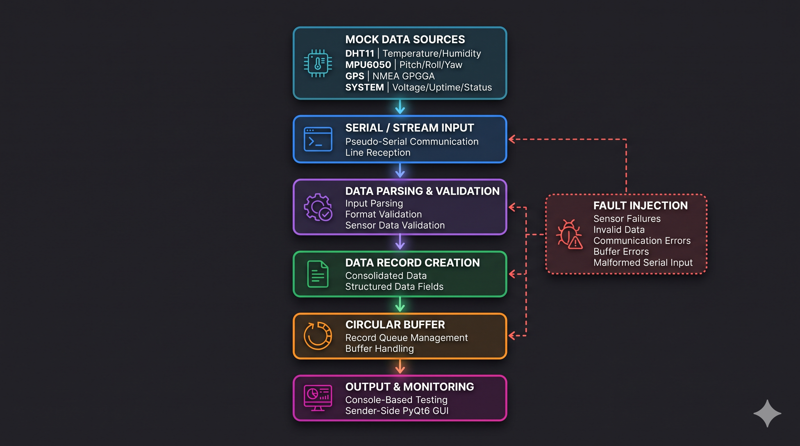
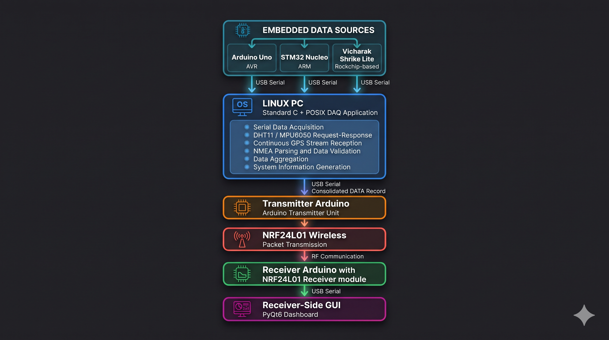

# Embedded_DAQ-COMM

Embedded Simulator and Comm system based on Standard C and POSIX libraries.

The Project is divided into two main parts:

### 1. Embedded Simulator
* **a)** Simulating Mock data of DHT11, MPU6050 and GPS Receiver as sensors and Use System info mock data as inputs to Simulate an Embedded DAQ system.
* **b)** Simulating Errors in Each individual Sensors, pseudo serial data stream and data buffer and handling it using data parser.
* **c) Bonus:** Graphical User Interface (GUI) to Monitor the Data acquired at Sender. A PyQT6 based simple GUI along with normal test and Simulating Errors.

### 2. Bonus: Actual DAQ and Communication Systems with Telematics
* **a)** Use of 3 sensors/dev boards connected to 3 COM ports emulating the communication interface while still generating random data.
* **b)** Interfacing heterogeneous architecture in devboards namely AVR, ARM and Rockchip.
* **c)** Ultimately, Communicating the data stream actually over NRF24 Module from one terminal to another upto 1 km.
* **d)** A simple GUI on receiver side to Visualize the communication and data.

---

## System Architecture

### 1. Embedded Simulator Architecture

### 2. Hardware based DAQ and COMM

